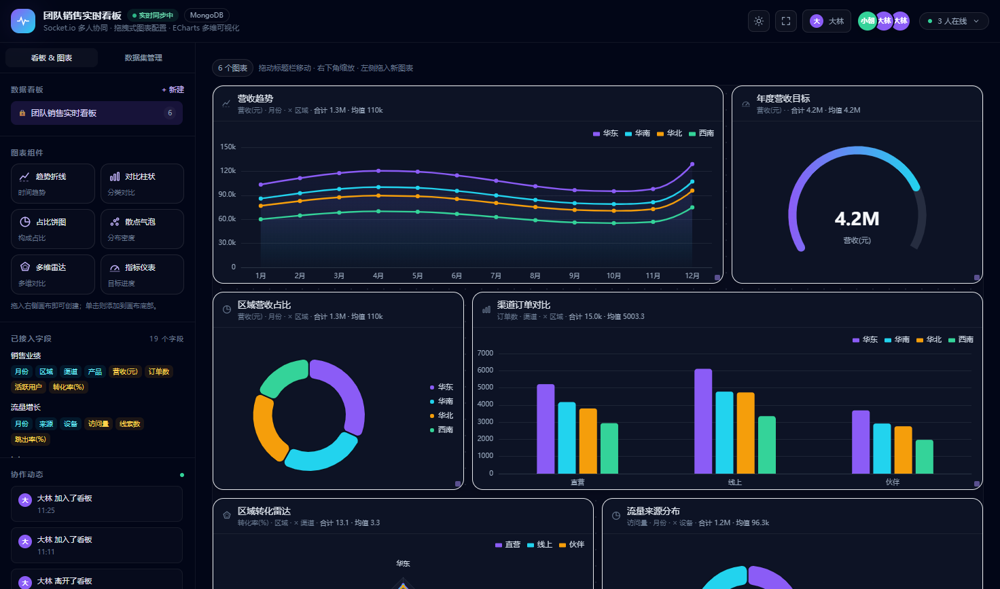

# PulseBoard · 实时协作数据看板

基于 WebSocket 的实时协作数据看板系统。支持多人同时编辑同一块看板，所见即所得地完成数据可视化。



## 功能特性

- **多图表类型**：折线图、柱状图、饼图、散点图、雷达图、仪表盘（Gauge）
- **实时协作**：基于 Socket.IO 的多房间架构，多人同时编辑同一块看板，操作实时同步
- **在线状态**：显示当前看板内的协作者列表及其正在编辑的图表
- **活动日志**：记录看板内的新增、更新、删除、加入、离开等操作
- **数据集管理**：支持 CSV / Excel 导入，自动推断字段类型（维度 / 度量）
- **数据聚合**：支持 sum / avg / count 三种聚合方式，可按维度分组并按 breakdown 拆成多系列
- **灵活布局**：12 列网格布局，图表可自由拖拽调整位置与尺寸
- **数据持久化**：MongoDB 存储看板与数据集，启动时自动写入种子数据

## 技术栈

### 前端（web）

| 技术 | 说明 |
| --- | --- |
| Vue 3 | Composition API + `<script setup>` |
| Vite 6 | 构建工具，本地开发端口 `5180` |
| TypeScript | 类型安全 |
| Tailwind CSS | 原子化样式 |
| ECharts 5 | 图表渲染 |
| Socket.IO Client | 实时通信 |

### 后端（server）

| 技术 | 说明 |
| --- | --- |
| Node.js + Express | HTTP 服务 |
| TypeScript | 类型安全 |
| Socket.IO | 实时通信 |
| MongoDB + Mongoose | 数据持久化 |
| csv-parse / xlsx | CSV / Excel 解析 |

## 目录结构

```
panel_chat/
├── package.json              # 根目录：聚合脚本（install:all / dev / build）
├── server/                   # 后端服务
│   ├── .env.example          # 环境变量示例
│   ├── package.json
│   ├── tsconfig.json
│   └── src/
│       ├── index.ts          # 入口：启动 Express + Socket.IO
│       ├── env.ts            # 环境变量读取
│       ├── db.ts             # MongoDB 连接
│       ├── models.ts         # Mongoose Schema（Dashboard / Dataset）
│       ├── store.ts          # 数据访问层（Store 接口 + MongoDB 实现）
│       ├── routes.ts         # REST API 路由（看板 / 数据集 / 聚合 / 导入）
│       ├── realtime.ts       # Socket.IO 实时事件处理
│       ├── aggregation.ts    # 聚合计算（sum / avg / count）
│       ├── seedData.ts       # 种子数据
│       └── types.ts          # 后端共享类型
└── web/                      # 前端应用
    ├── index.html
    ├── package.json
    ├── vite.config.ts        # Vite 配置（含 /api 与 /socket.io 代理）
    ├── tailwind.config.cjs
    └── src/
        ├── main.ts
        ├── App.vue           # 根组件
        ├── api.ts            # REST API 封装（fetch）
        ├── types.ts          # 前端共享类型
        ├── style.css
        ├── components/       # UI 组件
        │   ├── AppHeader.vue
        │   ├── SidebarPanel.vue
        │   ├── DashboardCanvas.vue
        │   ├── WidgetCard.vue
        │   ├── WidgetConfigModal.vue
        │   ├── ChartView.vue
        │   ├── JoinDialog.vue
        │   ├── ConfirmDialog.vue
        │   ├── PresenceBar.vue
        │   └── ...
        ├── composables/      # 组合式函数
        │   ├── useDashboard.ts   # 看板状态 + Socket 事件绑定
        │   ├── useIdentity.ts    # 用户身份（localStorage）
        │   ├── useTheme.ts       # 明暗主题
        │   └── useDialog.ts      # 全局确认弹窗
        └── utils/
            └── chartOption.ts    # ECharts 配置生成
```

## 环境要求

- Node.js（建议 18 及以上）
- MongoDB（本地或远程）

## 快速开始

### 1. 安装依赖

```bash
npm run install:all
```

该命令会分别安装 `server` 与 `web` 的依赖。

### 2. 配置环境变量

在 `server` 目录下复制示例并按需修改：

```bash
cp server/.env.example server/.env
```

```env
PORT=4000
MONGODB_URI=mongodb://127.0.0.1:27017/panel_chat
```

### 3. 启动开发环境

```bash
npm run dev
```

该命令使用 `concurrently` 同时启动前后端：

- 后端：`http://localhost:4000`
- 前端：`http://localhost:5180`（Vite 已配置 `/api` 与 `/socket.io` 代理到后端）

### 4. 构建生产产物

```bash
npm run build
```

## 架构说明

### 数据存储

后端通过 `Store` 接口（[server/src/store.ts](file:///c:/Users/ningc/Desktop/my-work/panel_chat/server/src/store.ts)）抽象数据访问，当前实现为 MongoDB。启动时若集合为空，会自动写入种子数据集与一个受保护的种子看板（`team-sales`，不可删除）。

### 实时协作

实时层由 [server/src/realtime.ts](file:///c:/Users/ningc/Desktop/my-work/panel_chat/server/src/realtime.ts) 处理，每个看板对应一个 Socket.IO 房间（`dashboard:<id>`）：

| 事件 | 方向 | 说明 |
| --- | --- | --- |
| `dashboard:join` | C→S | 加入看板房间，返回看板数据、在线列表、活动日志 |
| `dashboard:leave` | C→S | 离开当前房间 |
| `widget:create` | C→S | 新增图表，广播 `widget:created` |
| `widget:update` | C→S | 更新图表配置，广播 `widget:updated` |
| `widget:move` | C→S | 拖拽调整布局，广播 `widget:moved` |
| `widget:delete` | C→S | 删除图表，广播 `widget:deleted` |
| `widget:focus` | C→S | 标记当前正在编辑的图表，更新在线状态 |
| `user:update` | C→S | 更新昵称 / 头像色 |
| `presence:update` | S→C | 在线列表变更 |
| `activity` | S→C | 新的操作日志 |

### REST API

所有接口挂载在 `/api` 下：

- `GET  /health` — 健康检查，返回存储模式与数据量
- `GET  /dashboards` — 看板列表
- `POST /dashboards` — 新建看板
- `GET  /dashboards/:id` — 获取看板详情
- `DELETE /dashboards/:id` — 删除看板（种子看板受保护）
- `GET  /datasets` — 数据集列表
- `GET  /datasets/summaries` — 数据集摘要列表
- `GET  /datasets/:id` — 获取数据集
- `POST /datasets` — 新建数据集
- `PUT  /datasets/:id` — 更新数据集
- `DELETE /datasets/:id` — 删除数据集
- `POST /datasets/:id/rows` — 追加数据行
- `POST /datasets/:id/rows/replace` — 替换全部数据行
- `POST /datasets/:id/aggregate` — 聚合查询（维度 / 度量 / 聚合方式）
- `POST /datasets/:id/aggregate-total` — 单值聚合（用于仪表盘）
- `POST /datasets/:id/overview` — 数据集概览
- `POST /datasets/csv` — CSV 导入
- `POST /datasets/excel` — Excel 导入
- `PUT  /datasets/:id/csv` — 用 CSV 替换数据集行

### 前端状态

[useDashboard.ts](file:///c:/Users/ningc/Desktop/my-work/panel_chat/web/src/composables/useDashboard.ts) 是核心状态管理：

- 维护看板列表、当前看板、图表列表、在线列表、活动日志
- 通过 Socket 事件与服务端同步图表变更
- 图表的聚合结果按键（`widgetId:datasetId:dimension:metric:aggregation:breakdown`）缓存，配置变化时自动重新拉取
